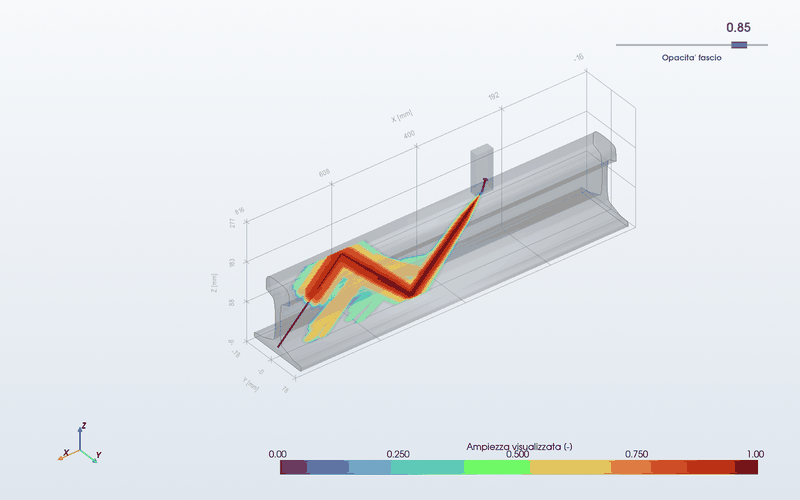
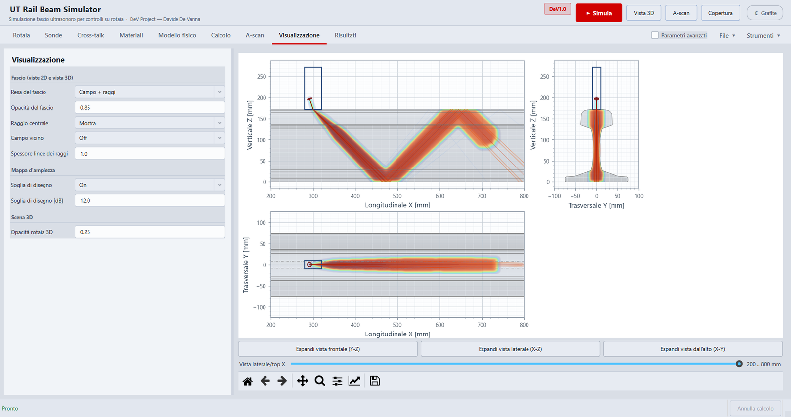
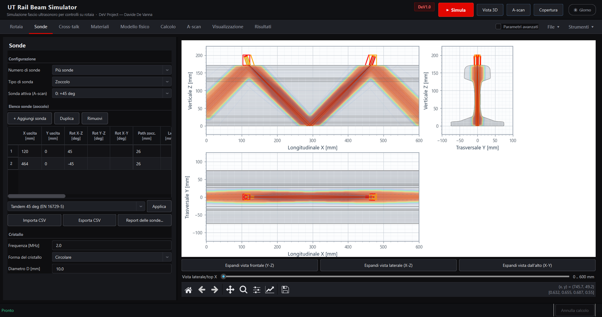
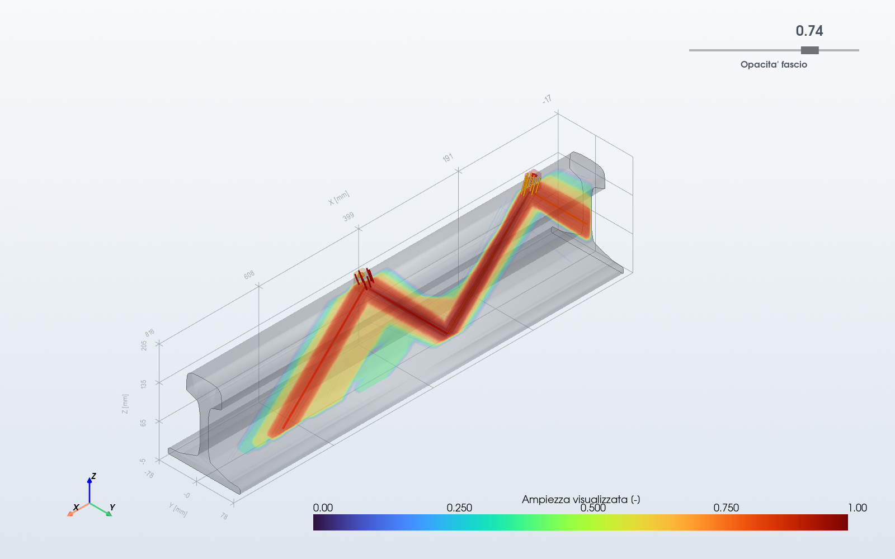
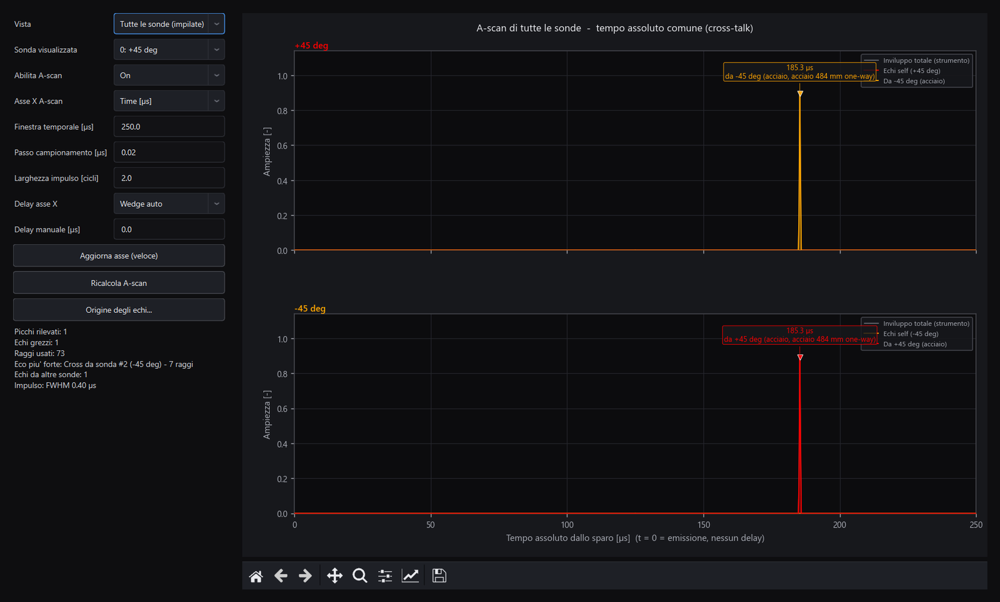
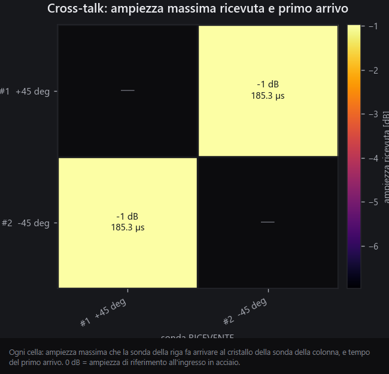
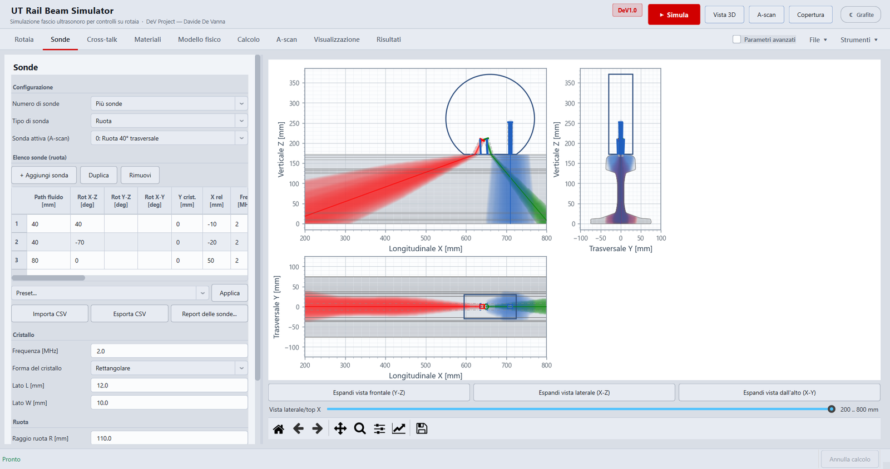
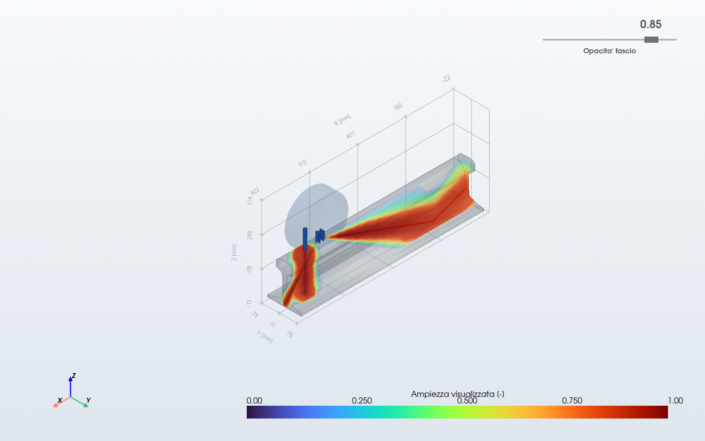
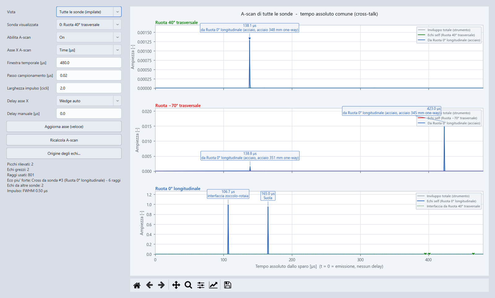
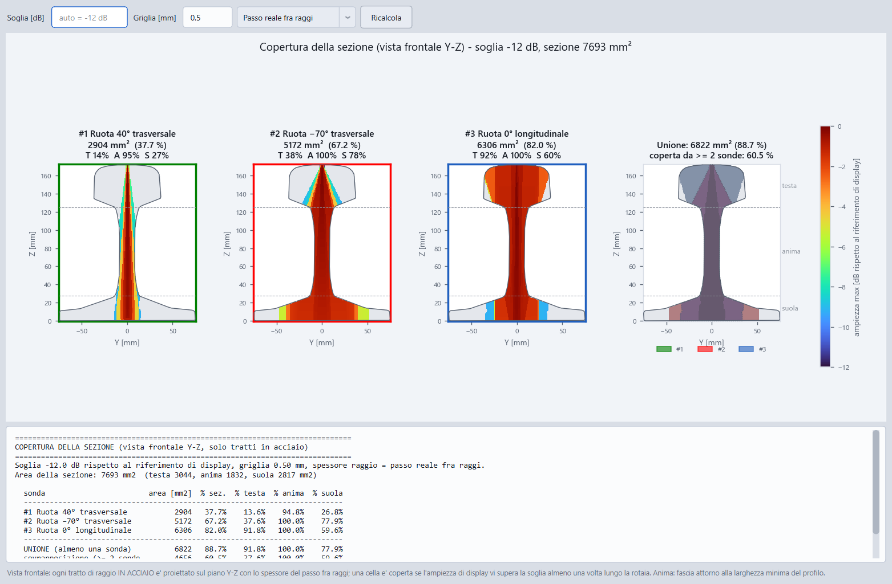

# UT Rail Beam Simulator · DeV1.0

**DeV Project** — Davide De Vanna

Simulatore del fascio ultrasonoro per il **controllo non distruttivo (UT) delle rotaie
ferroviarie**: segue il fascio di una o più sonde dentro la geometria reale della rotaia,
ne mostra la propagazione in 2D e 3D e sintetizza l'A-scan che vedrebbe lo strumento,
compreso il **cross-talk** fra sonde vicine.

> *EN — Ultrasonic beam simulator for non-destructive testing of railway rails: ray tracing
> in the real rail geometry (DXF profile or 3D mesh), single or multi-probe setups,
> synthetic A-scan and probe-to-probe cross-talk. Desktop application in Python.*

---

## Il problema

Sui treni di misura e sui carrelli d'ispezione le sonde a ultrasuoni lavorano a pochi
centimetri l'una dall'altra, ad angoli diversi (0°, 45°, 70°...). Progettare una
disposizione richiede di sapere **dove va il fascio** dentro una sezione complessa
(fungo, anima, suola, raccordi) e **quali echi arrivano a quale sonda**, comprese le vie
indesiderate da una sonda all'altra. Prove sperimentali e software commerciali generalisti
costano tempo e licenze; questo strumento risponde in pochi secondi.

## Cosa fa

| | |
|---|---|
| **Geometria reale** | profilo da file **DXF** (es. 60E1) o **mesh 3D** (OBJ/STL), oltre a profili parametrici |
| **Sonde** | una o più sonde, a **zoccolo** o a **ruota**, orientabili su tre rotazioni; tabella con preset normativi (tandem 45°, 70°, carrello completo) |
| **Fisica** | legge di Snell vettoriale, divergenza del cristallo rettangolare/circolare, campo vicino, coefficienti di trasmissione **a incidenza obliqua** fluido/solido, riflessione sulle pareti con **conversione di modo** (Knott/Zoeppritz), attenuazione |
| **A-scan** | segnale sintetico per ogni sonda, con origine di ogni eco (superficie e punto di riflessione) e ricerca automatica dei percorsi che tornano al cristallo |
| **Cross-talk** | ricezione fra sonde per **integrazione sull'apertura** del cristallo e **reciprocità**: l'ampiezza non dipende dal numero di raggi tracciati; matrice "chi sente chi" in dB |
| **Visualizzazione** | tavola tecnica 2D a scala unica, vista 3D interattiva, tre rese del fascio (campo continuo stile CIVA, campo + raggi, raggi) |

## Esempio: tandem a 45° e cross-talk

Due sonde a onde trasversali contrapposte, a un salto completo di distanza: il fascio
della prima rimbalza sulla suola e arriva al cristallo della seconda.

| Vista 3D | A-scan di tutte le sonde |
|---|---|
|  |  |

Ogni eco ricevuto porta il colore della sonda che l'ha emesso; la matrice del cross-talk
riassume ampiezza e tempo del primo arrivo per ogni coppia di sonde.

## Esempio: sonda a ruota con tre cristalli

Una ruota piena di fluido che rotola sulla rotaia, con tre cristalli: 40° e −70° a onde
trasversali, 0° a onde longitudinali. Il programma posiziona ogni cristallo con la legge
di Snell perché il fascio entri nel punto voluto, e segue anche i rimbalzi dentro la ruota.

| Vista 3D | A-scan delle tre sonde |
|---|---|
|  |  |

### Copertura della sezione

Quanta parte della sezione della rotaia ogni sonda illumina sopra soglia (qui −12 dB),
divisa per zona (fungo, anima, suola), e quanto la copre la combinazione delle sonde:
in questo esempio l'**88,7%** della sezione, con la suola laterale come zona più scoperta.

## Rigore: verifica della fisica

- **Verifica sulla bibliografia** dei modelli (Ono, *Applied Sciences* 2020; articoli
  NDT.net; note tecniche Evident/Olympus; NDE-ED), con un **solutore di onde piane
  indipendente** come riferimento dove i testi non erano accessibili:
  trovati e corretti 5 errori, fra cui un coefficiente di divergenza preso dalla formula
  del campo vicino che allargava il fascio del 18%; 8 approssimazioni residue
  **quantificate in dB**.
- **Bilanci d'energia** chiusi a 1,0000 a ogni angolo per interfacce e superfici libere;
  per esempio un'onda trasversale a 30° sulla parete perde 17,8 dB per conversione in
  longitudinale, sopra l'angolo critico di 33,2° si riflette tutta.
- **Convergenza del cross-talk**: con 6,2 volte i raggi l'ampiezza ricevuta cambia del 5,6%.
- **Ogni ottimizzazione è verificata bit per bit**: stessi risultati numerici e stesse
  immagini prima e dopo.

## Prestazioni

| Operazione | Prima | Dopo |
|---|---|---|
| Vista 3D a campo continuo (configurazione reale) | 86,7 s | **7,6 s** |
| Calcolo multi-sonda con cross-talk | 14,3 s | **10,3 s** |
| Calcolo con profilo DXF da 1.154 vertici (prima ottimizzazione) | 152 s | **16,7 s** |

Tracciamento vettorializzato in NumPy, elaborazioni volumetriche multi-thread, calcolo in
secondo piano annullabile in ~10 ms.

## Tecnologie

Python 3.13 · PySide6 (Qt) · NumPy · SciPy · Matplotlib · PyVista / VTK · Trimesh · ezdxf

## Metodo di lavoro

Competenza di dominio NDT (fisica degli ultrasuoni, normativa ferroviaria) unita a uno
sviluppo **assistito da AI**: architettura, modelli fisici e verifiche decisi e
controllati da me, con agenti specializzati (prestazioni, UX, ricerca bibliografica) e
regole di verifica severe (confronti numerici automatici, nessun risultato accettato
senza prova).

---

**Codice sorgente:** privato e protetto (© 2026 Davide De Vanna, tutti i diritti riservati).
Disponibile **su richiesta** per colloqui tecnici, in sola lettura o in dimostrazione dal vivo.

**Contatti:** [davide.devanna94@gmail.com](mailto:davide.devanna94@gmail.com)
